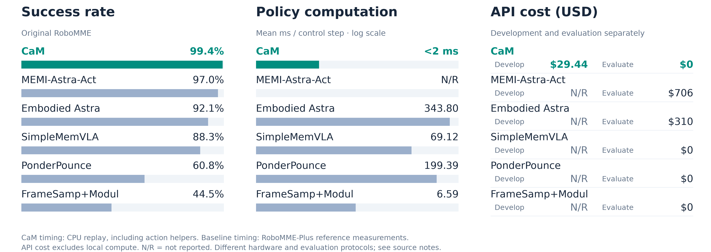
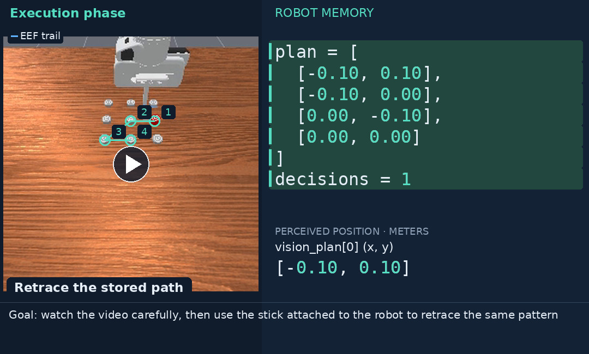
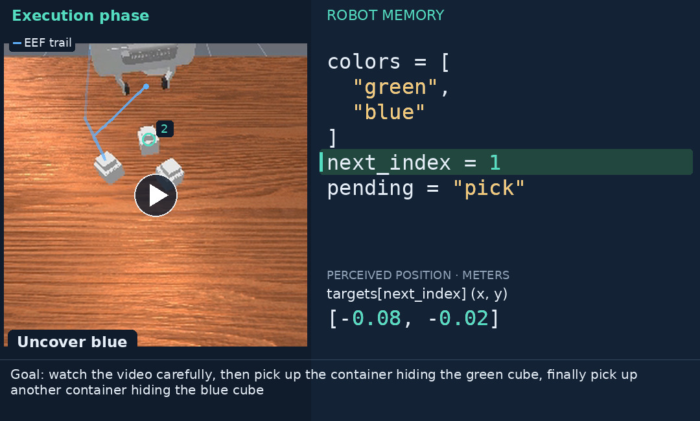
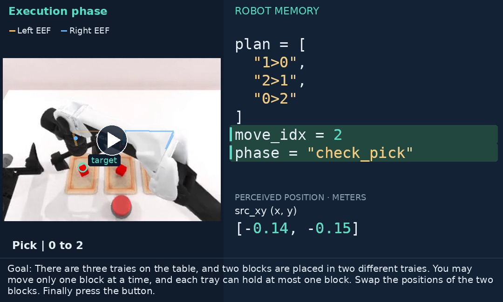
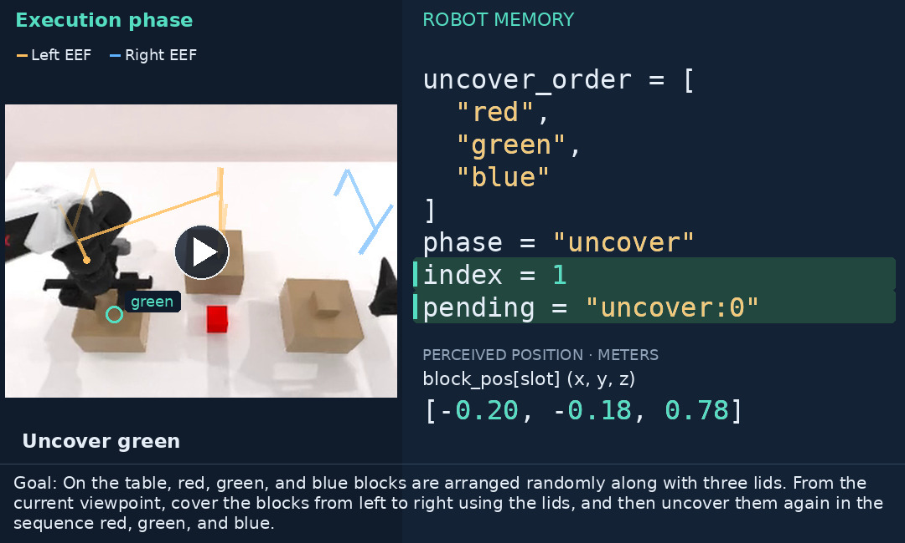
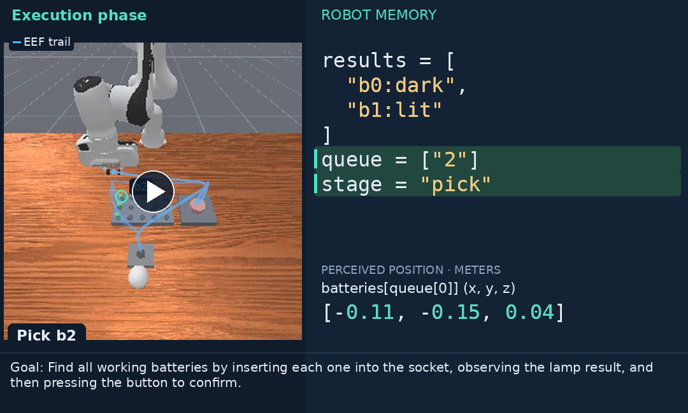
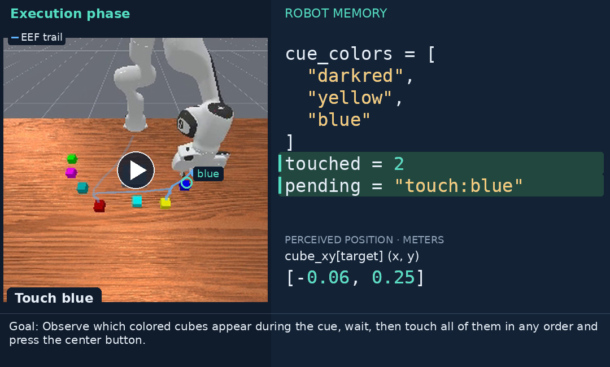
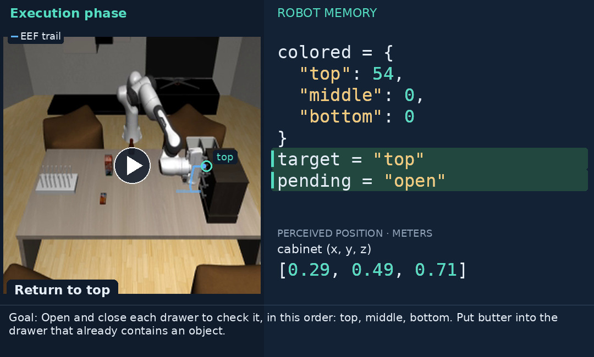
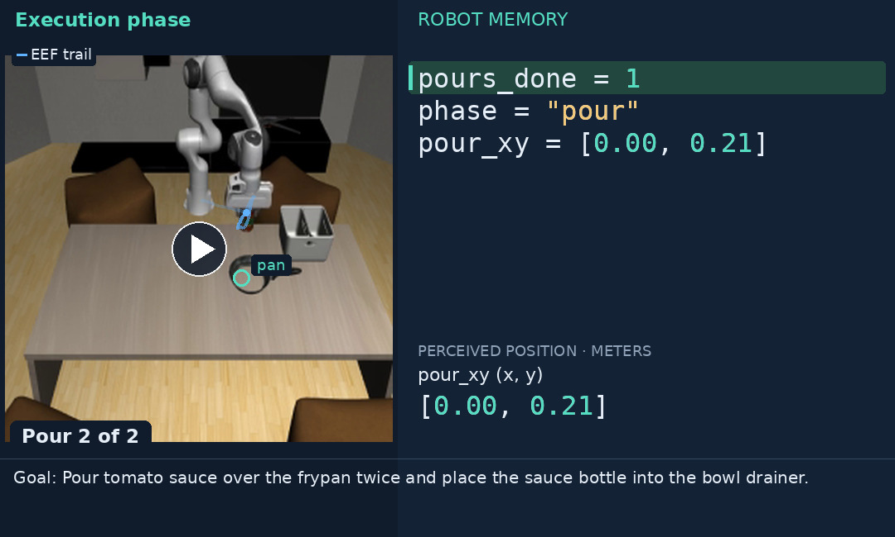

# CaM · Robot Memory as Code

[Results](#results) · [Try it](#try-it) · [Demonstrations](docs/getting_started.md#demonstration-packages) · [Documentation](docs/README.md)

**CaM learns robot memory as code.**

A coding agent turns demonstrations and optional practice into a Python program
that remembers, decides, and acts.

The learned program carries memory across observations and runs with
**zero model calls during evaluation**.

## Results


The comparison uses nine shared RMBench tasks and five shared MIKASA task identities
(CaM: **100.0%**, with the CPU-physics correction). Published methods use different
training and evaluation protocols; full-suite results and provenance are in the docs.

[More results, coverage, and provenance →](docs/results.md)

## Learn once, execute as code

RoboMME's 16 memory programs used **$29.44 in reported development API cost**.
Their 800 held-out evaluations made **zero model calls**.



Timing measures perception and memory decisions on recorded observations, excluding
action-tool execution and simulation. [Measurement details and figure sources](docs/figures/README.md).

## Successful held-out episodes

Click a preview to open the MP4. Each video shows the recorded task goal, phase,
end-effector trail, and relevant memory and perceived positions.
[Video sources and presentation details](docs/media/README.md).

### RoboMME

**PatternLock**

> watch the video carefully, then use the stick attached to the robot to retrace the same pattern

[](docs/media/robomme-pattern-lock.mp4)

**VideoUnmaskSwap**

> watch the video carefully, then pick up the container hiding the green cube, finally pick up another container hiding the blue cube

[](docs/media/robomme-hidden-objects.mp4)

### RMBench

**swap_blocks**

> There are three traies on the table, and two blocks are placed in two different traies. You may move only one block at a time, and each tray can hold at most one block. Swap the positions of the two blocks. Finally press the button.

[](docs/media/rmbench-swap-blocks.mp4)

**cover_blocks**

> On the table, red, green, and blue blocks are arranged randomly along with three lids. From the current viewpoint, cover the blocks from left to right using the lids, and then uncover them again in the sequence red, green, and blue.

[](docs/media/rmbench-cover-blocks.mp4)

### MIKASA-Robo

**BatteriesCheckerEasy-3-VLA-v0**

> Find all working batteries by inserting each one into the socket, observing the lamp result, and then pressing the button to confirm.

[](docs/media/mikasa-batteries.mp4)

**SeqOfColors3-VLA-v0**

> Observe which colored cubes appear during the cue, wait, then touch all of them in any order and press the center button.

[](docs/media/mikasa-color-sequence.mp4)

### RoboMemArena

**T04_ButterNonEmptyDrawer**

> Open and close each drawer to check it, in this order: top, middle, bottom. Put butter into the drawer that already contains an object.

[](docs/media/robomemarena-drawers.mp4)

**T07_PourSauceFrypanTwice**

> Pour tomato sauce over the frypan twice and place the sauce bottle into the bowl drainer.

[](docs/media/robomemarena-pour-twice.mp4)

## Try it

[Install the shared harness and a benchmark environment](docs/getting_started.md),
then evaluate its published memory programs. No demonstrations or model credentials
are needed for this step.

```bash
# All 16 RoboMME tasks; five concurrent evaluation jobs per GPU.
python scripts/evaluate_solutions.py solutions/robomme/demo_only_25 \
  --output validate_runs/robomme --gpus 0 1 --workers-per-gpu 5
```

| Benchmark | Published memory programs | Run and reproduce |
|---|---|---|
| RoboMME | [25 demonstrations](solutions/robomme/demo_only_25/) | [Guide](docs/benchmarks/robomme/README.md) |
| RMBench | [50 demonstrations](solutions/rmbench/demo_only_50/) | [Guide](docs/benchmarks/rmbench/README.md) |
| MIKASA-Robo | [50 demonstrations + interaction](solutions/mikasa_robo/demo_interaction_50/) | [Guide](docs/benchmarks/mikasa_robo/README.md) |
| RoboMemArena | [50 demonstrations + interaction](solutions/robomemarena/demo_interaction_50/) | [Guide](docs/benchmarks/robomemarena/README.md) |

## Reproduce development

The demonstrations are successful trajectories collected through replay:
**25 per task for RoboMME and up to 50 per task for the other benchmarks**.
CaM develops memory code using only the assigned trajectories and, when interaction
is enabled, training rollouts from those same demonstration seeds.

[Download the demonstrations and configure your coding client](docs/getting_started.md),
then choose a data path and a directory for development logs:

```bash
python scripts/develop_batch.py start configs/robomme/experiments/demo_only_25.json \
  --dataset /path/to/demos/robomme --output validate_runs/robomme_development \
  --workers 8 --gpus 0 1
```

**Eight concurrent development jobs; five evaluation jobs per GPU.**
[Batch evaluation, prompts, and reproduction details](docs/reproducing.md) ·
[Five-episode sanity checks](docs/solutions.md#sanity-checks) ·
[Live dashboard and experiment galleries](docs/website.md)

[All documentation](docs/README.md) · [Architecture](docs/architecture.md) ·
[Selected revalidation tasks](docs/validatd_task.md)

Apache-2.0. Benchmark code and assets retain their upstream licenses; see [NOTICE](NOTICE).
