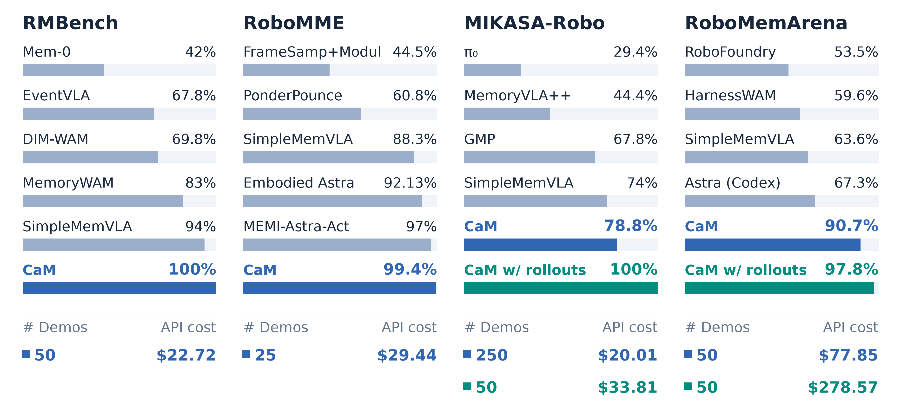

# 🧠 Code-as-Memory: Self-improved Robot Memory via Coding Agents

<h3><strong><em>Can robot memory just be an executable Python program?</em></strong></h3>

**Code-as-Memory (CaM)** introduces **executable code as explicit, persistent robot memory**. A coding agent distills demonstrations into a Python program that maintains and updates memory through structured variables (e.g., `dict`, `list`), enabling robots to **perceive, remember, reason and act** entirely through Python execution, without relying on any external models during inference.

⚡ **No Training. No Model Calls. Near-Zero Latency.**

- **No model training** during development
- **Zero model/API calls** during inference
- **<5 ms average policy computation per control step**

CaM achieves **near-perfect performance across four popular robot memory benchmarks**, significantly outperforming prior approaches with much lower **computational cost, financial expense, and inference latency**.



**Settings:** The official training-demo counts per task are 100 for RoboMME, 250 for MIKASA-Robo, 50 for RMBench, and 100 for RoboMemArena. **CaM** learns from offline demos (25/task for RoboMME, 250 for MIKASA-Robo, 50 for RMBench/RoboMemArena). **CaM w/ rollouts** use 50 demos/task and allows up to 50 rollout attempts to interact with simulators using the same demo seeds. Reported costs reflect only development-time API usage (Opus 5.5).

[More results can be found here →](docs/results.md)


## Rollout Examples

### RMBench

**Task: swap_blocks**

> **Task Goal:** There are three traies on the table, and two blocks are placed in two different traies. You may move only one block at a time, and each tray can hold at most one block. Swap the positions of the two blocks. Finally press the button.

https://github.com/user-attachments/assets/02ce7f4e-5902-4bbe-9a5f-9abf006fd6e2

**Task: cover_blocks**

> **Task Goal:** On the table, red, green, and blue blocks are arranged randomly along with three lids. From the current viewpoint, cover the blocks from left to right using the lids, and then uncover them again in the sequence red, green, and blue.

https://github.com/user-attachments/assets/8bc49f75-d240-40cf-b217-41bd53b903b4

### MIKASA-Robo

**Task: BatteriesCheckerEasy-3-VLA-v0**

> **Task Goal:** Find all working batteries by inserting each one into the socket, observing the lamp result, and then pressing the button to confirm.

https://github.com/user-attachments/assets/fa3f70b0-4bc0-47fa-a284-8898e2bf3766

**Task: SeqOfColors3-VLA-v0**

> **Task Goal:** Observe which colored cubes appear during the cue, wait, then touch all of them in any order and press the center button.

https://github.com/user-attachments/assets/92a7bc82-3ee9-4226-a126-daa0627414f2

### RoboMME

**Task: PatternLock**

> **Task Goal:** watch the video carefully, then use the stick attached to the robot to retrace the same pattern

https://github.com/user-attachments/assets/ab737c73-8a91-4fd8-9b0d-ee3d25897a04

**Task: VideoUnmaskSwap**

> **Task Goal:** watch the video carefully, then pick up the container hiding the green cube, finally pick up another container hiding the blue cube

https://github.com/user-attachments/assets/549ebd0c-9a4d-4802-b2fb-8c66f9871807

### RoboMemArena

**Task: T04_ButterNonEmptyDrawer**

> **Task Goal:** Open and close each drawer to check it, in this order: top, middle, bottom. Put butter into the drawer that already contains an object.

https://github.com/user-attachments/assets/145fa12c-932b-417a-b427-e35c7bcfc10f

**Task: T07_PourSauceFrypanTwice**

> **Task Goal:** Pour tomato sauce over the frypan twice and place the sauce bottle into the bowl drainer.

https://github.com/user-attachments/assets/f1019d46-e3c0-4bfb-9147-c4ff4dbbe232

## Try it directly

[Install the shared harness and a benchmark environment](docs/getting_started.md),
then evaluate our published memory programs. No demonstrations or model credentials
are needed for this step.

| Benchmark | Published memory programs | Run and reproduce |
|---|---|---|
| RoboMME | [Learning from 25 demos](solutions/robomme/demo_only_25/) | [Guide](docs/benchmarks/robomme.md) |
| RMBench | [Learning from  50 demos](solutions/rmbench/demo_only_50/) | [Guide](docs/benchmarks/rmbench.md) |
| MIKASA-Robo | [Learning from 50 demos + 50 rollouts](solutions/mikasa_robo_vla_suite/demo_interaction_50/) | [Guide](docs/benchmarks/mikasa_robo.md) |
| RoboMemArena | [Learning from 50 demos + 50 rollouts](solutions/robomemarena/demo_interaction_50/) | [Guide](docs/benchmarks/robomemarena.md) |

## Reproduce development

[Download the development logs and code solutions](https://huggingface.co/datasets/Yinpei/CaM_development_logs).

The prepared packages include successful relayed trajectoris, and memory-based code polices development for different settings. Final evaluation uses separate, unseen seeds after the policy is frozen.

**Development access:** The coding agent uses assigned demonstrations, public task/interface documentation, and budgeted training-rollout feedback when interaction is enabled. It has no access to privileged simulator state (ground-truth object poses or hidden task state), simulator source code, held-out evaluation data/results, or prior solutions. See the [development protocol](docs/reproducing.md#prompts-and-isolation).

[Download the demonstrations and configure your coding client](docs/getting_started.md),
then choose a data path and a directory for development logs:

```bash
python scripts/develop_batch.py start configs/robomme/experiments/demo_only_25.json \
  --dataset /path/to/demos/robomme --output runs/robomme_development \
  --workers 8 --gpus 0 1
```

[Benchmark guides](docs/benchmarks/README.md) · [Architecture](docs/architecture.md)

Apache-2.0. Benchmark code and assets retain their upstream licenses; see [NOTICE](NOTICE).
