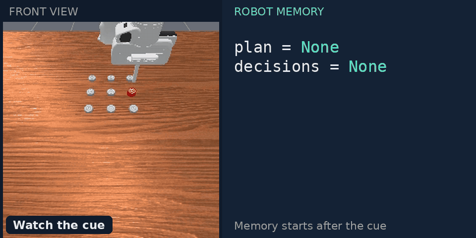
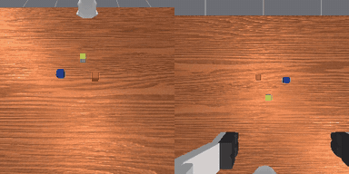
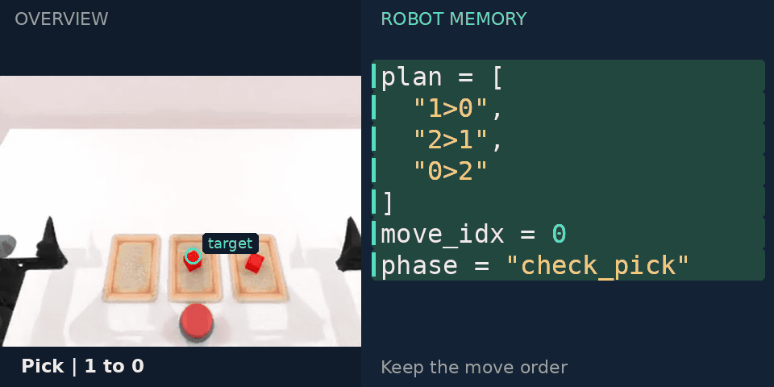
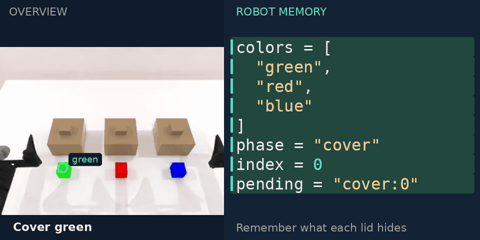
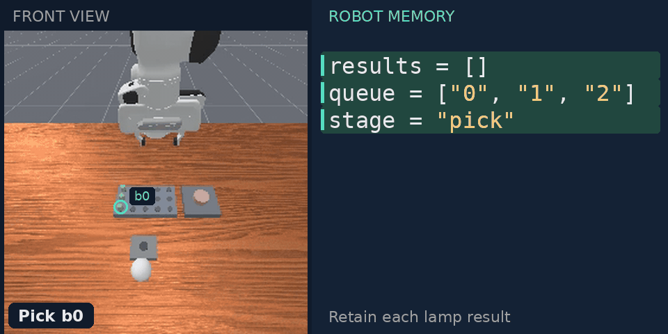
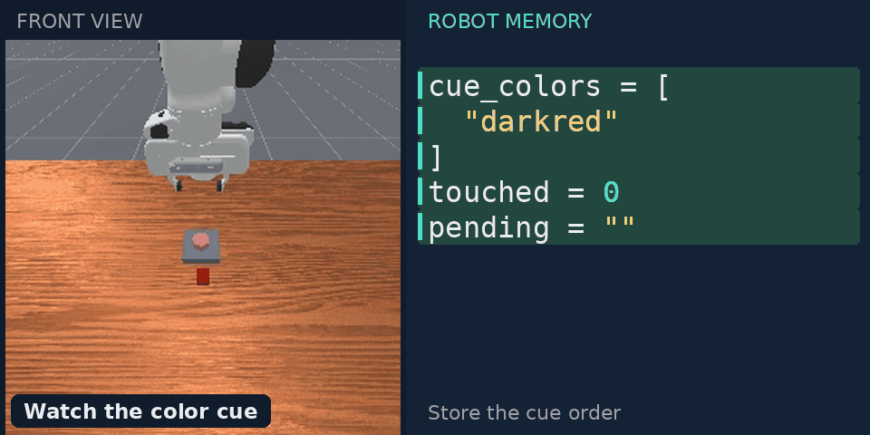
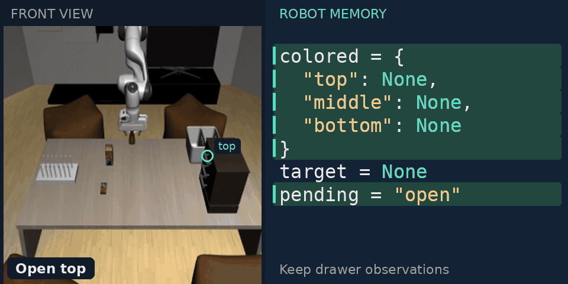
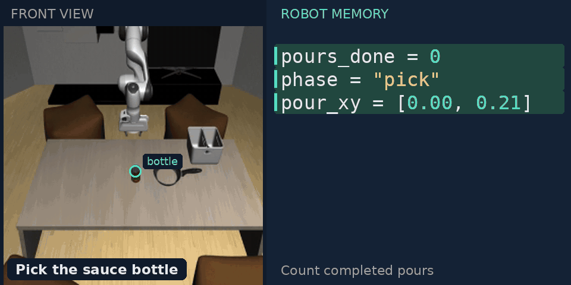

# CaM · Robot Memory as Code

[Results](#results) · [Try it](#try-it) · [Demonstrations](docs/getting_started.md#demonstration-packages) · [Experiment details](docs/reproducing.md)

**CaM learns robot memory as code.**

A coding agent turns demonstrations and optional practice into a Python program
that remembers, decides, and acts.

The learned program carries memory across observations and runs with
**zero model calls during evaluation**.

## Results


The comparison uses nine shared RMBench tasks and five shared MIKASA task identities
(CaM: **250/250, 100.0%**, from fresh 50-demo-plus-interaction policies). Published methods use different
training and evaluation protocols; full-suite results and provenance are in the docs.

[More results, coverage, and provenance →](docs/results.md)

## Learn once, execute as code

RoboMME's 16 memory programs used **$29.44 in reported development API cost**.
Their 800 held-out evaluations made **zero model calls**.


Timing measures perception and memory decisions on recorded observations, excluding
action-tool execution and simulation. [Measurement details and figure sources](docs/figures/README.md).

## Robot memory in action

Selected successful held-out episodes, with the robot's recorded memory beside the
front view. Highlighted fields show what changes; scene markers connect remembered
locations to actions. [How the GIFs are made](docs/media/README.md).

### RoboMME

**Remember a pattern** · Store the path, then retrace it.

[](docs/media/robomme-pattern-lock.gif)

**Track hidden objects** · Recall the targets after their containers move.

[](docs/media/robomme-hidden-objects.gif)

### RMBench

**Keep track of a swap** · Follow a three-move plan through an empty tray.

[](docs/media/rmbench-swap-blocks.gif)

**Remember what is covered** · Retain the colors, then uncover them in order.

[](docs/media/rmbench-cover-blocks.gif)

### MIKASA-Robo

**Remember which batteries work** · Keep each lamp result as testing continues.

[](docs/media/mikasa-batteries.gif)

**Recall a color sequence** · Turn an earlier cue into an ordered sequence of touches.

[](docs/media/mikasa-color-sequence.gif)

### RoboMemArena

**Remember what is inside** · Keep drawer observations and return to the occupied one.

[](docs/media/robomemarena-drawers.gif)

**Count completed pours** · Update the remembered count between pours.

[](docs/media/robomemarena-pour-twice.gif)

## Try it

[Install the shared harness and a benchmark environment](docs/getting_started.md),
then evaluate its published memory programs. No demonstrations or model credentials
are needed for this step.

```bash
# All 16 RoboMME tasks; five concurrent evaluation jobs per GPU.
python scripts/evaluate_solutions.py solutions/robomme/demo_only_25 \
  --output validate_runs/robomme --gpus 0 1 --workers-per-gpu 5
```

| Benchmark | Published memory programs | Run and reproduce |
|---|---|---|
| RoboMME | [25 demonstrations](solutions/robomme/demo_only_25/) | [Guide](docs/benchmarks/robomme.md) |
| RMBench | [50 demonstrations](solutions/rmbench/demo_only_50/) | [Guide](docs/benchmarks/rmbench.md) |
| MIKASA-Robo | [50 demonstrations + 50 training attempts](solutions/mikasa_robo/demo_interaction_50/) | [Guide](docs/benchmarks/mikasa_robo.md) |
| RoboMemArena | [Up to 50 demonstrations + matching training attempts](solutions/robomemarena/demo_interaction_50/) | [Guide](docs/benchmarks/robomemarena.md) |

## Reproduce development

The demonstrations are successful trajectories collected through replay:
**25 per task for RoboMME and up to 50 per task for the other benchmarks**.
**Demo + interaction means 50 demonstrations and at most 50 simulator training
attempts per task across the entire development process.** Each attempt resets
to one of those 50 training-demonstration seeds, used once. Failed attempts also
consume the budget. RoboMemArena's T04 has 32 demonstrations and 32 attempts.
Held-out evaluation uses separate seeds after the policy is frozen.

[Download the demonstrations and configure your coding client](docs/getting_started.md),
then choose a data path and a directory for development logs:

```bash
python scripts/develop_batch.py start configs/robomme/experiments/demo_only_25.json \
  --dataset /path/to/demos/robomme --output validate_runs/robomme_development \
  --workers 8 --gpus 0 1
```

**Eight concurrent development jobs; five evaluation jobs per GPU.**
[Batch evaluation, prompts, and reproduction details](docs/reproducing.md) ·
[Five-episode sanity checks](docs/solutions.md#sanity-checks) ·
[Live dashboard and experiment galleries](docs/website.md)

[Benchmark guides](docs/benchmarks/) · [Architecture](docs/architecture.md)

Apache-2.0. Benchmark code and assets retain their upstream licenses; see [NOTICE](NOTICE).
