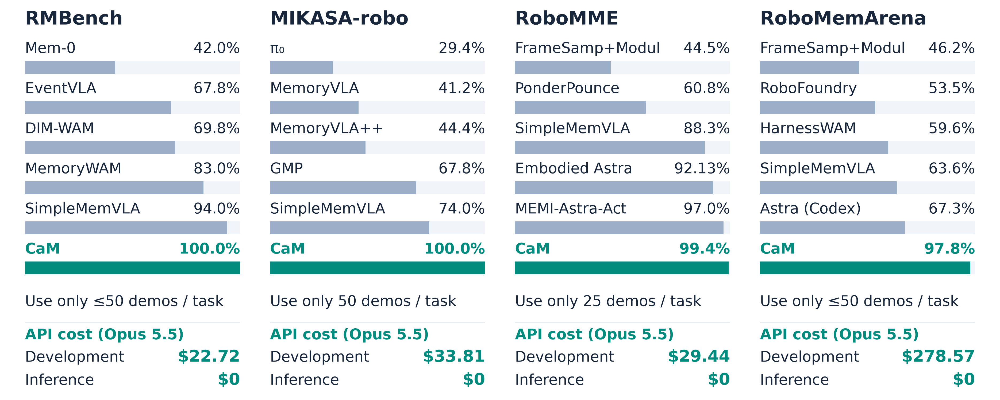

# 🧠 Code-as-Memory: Robots That Remember with Code

[Results](docs/results.md) · [Try it](#try-it) · [Demonstrations](docs/getting_started.md#demonstration-packages) · [Experiment details](docs/reproducing.md)

**What if robot memory could just be an executable Python program?**

**Code-as-Memory (CaM)** introduces **executable code as explicit, persistent robot memory**. A coding agent distills demonstrations into a Python program that maintains and updates memory through structured variables (e.g., `dict`, `list`), enabling robots to **perceive, remember, reason and act** entirely through Python execution, without relying on any external models during inference.

⚡ **No Training. No Model Calls. Near-Zero Latency.**

- **No model training** during development
- **Zero model/API calls** during inference
- **<5 ms inference latency** through lightweight Python execution

CaM achieves **near-perfect performance across four robot memory benchmarks**, outperforming prior approaches at a fraction of the **computational cost, financial expense, and inference latency**.




The comparison uses nine shared RMBench tasks and five shared MIKASA task identities
(CaM: **250/250, 100.0%**, from fresh 50-demo-plus-interaction policies). Published methods use different
training and evaluation protocols; full-suite results and provenance are in the docs.

[More results can be found here →](docs/results.md)


## Rollout Examples

### RMBench

**Task: swap_blocks**

> **Task Goal:** There are three traies on the table, and two blocks are placed in two different traies. You may move only one block at a time, and each tray can hold at most one block. Swap the positions of the two blocks. Finally press the button.

https://github.com/user-attachments/assets/02ce7f4e-5902-4bbe-9a5f-9abf006fd6e2

**Task: cover_blocks**

> **Task Goal:** On the table, red, green, and blue blocks are arranged randomly along with three lids. From the current viewpoint, cover the blocks from left to right using the lids, and then uncover them again in the sequence red, green, and blue.

https://github.com/user-attachments/assets/8bc49f75-d240-40cf-b217-41bd53b903b4

### MIKASA-Robo

**Task: BatteriesCheckerEasy-3-VLA-v0**

> **Task Goal:** Find all working batteries by inserting each one into the socket, observing the lamp result, and then pressing the button to confirm.

https://github.com/user-attachments/assets/fa3f70b0-4bc0-47fa-a284-8898e2bf3766

**Task: SeqOfColors3-VLA-v0**

> **Task Goal:** Observe which colored cubes appear during the cue, wait, then touch all of them in any order and press the center button.

https://github.com/user-attachments/assets/92a7bc82-3ee9-4226-a126-daa0627414f2

### RoboMME

**Task: PatternLock**

> **Task Goal:** watch the video carefully, then use the stick attached to the robot to retrace the same pattern

https://github.com/user-attachments/assets/ab737c73-8a91-4fd8-9b0d-ee3d25897a04

**Task: VideoUnmaskSwap**

> **Task Goal:** watch the video carefully, then pick up the container hiding the green cube, finally pick up another container hiding the blue cube

https://github.com/user-attachments/assets/549ebd0c-9a4d-4802-b2fb-8c66f9871807

### RoboMemArena

**Task: T04_ButterNonEmptyDrawer**

> **Task Goal:** Open and close each drawer to check it, in this order: top, middle, bottom. Put butter into the drawer that already contains an object.

https://github.com/user-attachments/assets/145fa12c-932b-417a-b427-e35c7bcfc10f

**Task: T07_PourSauceFrypanTwice**

> **Task Goal:** Pour tomato sauce over the frypan twice and place the sauce bottle into the bowl drainer.

https://github.com/user-attachments/assets/f1019d46-e3c0-4bfb-9147-c4ff4dbbe232

## Try it

[Install the shared harness and a benchmark environment](docs/getting_started.md),
then evaluate its published memory programs. No demonstrations or model credentials
are needed for this step.

```bash
# All 16 RoboMME tasks; five concurrent evaluation jobs per GPU.
python scripts/evaluate_solutions.py solutions/robomme/demo_only_25 \
  --output validate_runs/robomme --gpus 0 1 --workers-per-gpu 5
```

| Benchmark | Published memory programs | Run and reproduce |
|---|---|---|
| RoboMME | [25 demonstrations](solutions/robomme/demo_only_25/) | [Guide](docs/benchmarks/robomme.md) |
| RMBench | [50 demonstrations](solutions/rmbench/demo_only_50/) | [Guide](docs/benchmarks/rmbench.md) |
| MIKASA-Robo | [50 demonstrations + 50 training attempts](solutions/mikasa_robo/demo_interaction_50/) | [Guide](docs/benchmarks/mikasa_robo.md) |
| RoboMemArena | [Up to 50 demonstrations + matching training attempts](solutions/robomemarena/demo_interaction_50/) | [Guide](docs/benchmarks/robomemarena.md) |

## Reproduce development

[Download the development logs, code, results and videos](https://huggingface.co/datasets/Yinpei/CaM_develop_logs)
(5.54 GB compressed; [download instructions](docs/getting_started.md#development-logs)).

The demonstrations are successful trajectories collected through replay:
**25 per task for RoboMME and up to 50 per task for the other benchmarks**.
**Demo + interaction means 50 demonstrations and at most 50 simulator training
attempts per task across the entire development process.** Each attempt resets
to one of those 50 training-demonstration seeds, used once. Failed attempts also
consume the budget. RoboMemArena's T04 has 32 demonstrations and 32 attempts.
Held-out evaluation uses separate seeds after the policy is frozen.

[Download the demonstrations and configure your coding client](docs/getting_started.md),
then choose a data path and a directory for development logs:

```bash
python scripts/develop_batch.py start configs/robomme/experiments/demo_only_25.json \
  --dataset /path/to/demos/robomme --output validate_runs/robomme_development \
  --workers 8 --gpus 0 1
```

**Eight concurrent development jobs; five evaluation jobs per GPU.**
[Batch evaluation, prompts, and reproduction details](docs/reproducing.md) ·
[Five-episode sanity checks](docs/solutions.md#sanity-checks) ·
[Live dashboard and experiment galleries](docs/website.md)

[Benchmark guides](docs/benchmarks/) · [Architecture](docs/architecture.md)

Apache-2.0. Benchmark code and assets retain their upstream licenses; see [NOTICE](NOTICE).
