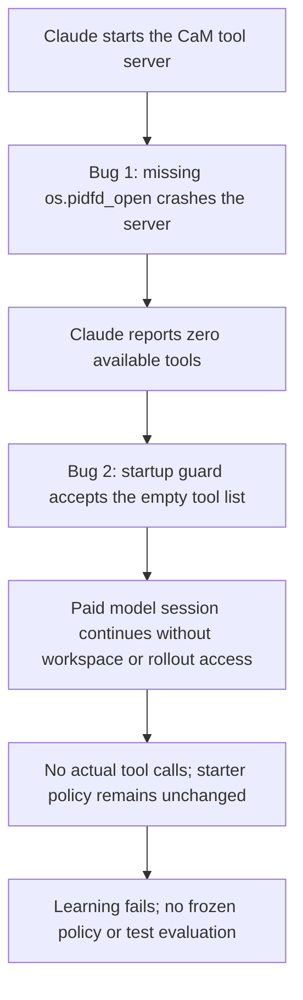

# MIKASA-Robo v2: CaM tool-server startup failure

Incident date: **2026-11-08**. Machine: `sled-aspen.eecs.umich.edu`.

**Two bugs in CaM's infrastructure prevented learning from starting.** A Python
compatibility assumption crashed the CaM tool server. A missing validation check
then allowed Claude to continue without any connected tools. These failures
occurred before the learner could develop a policy or execute training rollouts.

This report records the failed batch and the verified repair. Replacement-batch
progress is tracked separately in [the development inventory](mikasa_v2_progress.md).

## Intended behavior and observed failure

The experiment assigns 80 tasks, each with 50 replayed RGB-D demonstrations and
50 counted training attempts on those same demo identities, once each. Claude
Code / Opus 5.5 should develop each policy through six CaM tools:
`command`, `read_image`, `usage`, `snapshot`, `validate`, and `rollout`.
After learning finishes and the R050 policy freezes, the host evaluates 50
separate held-out episodes per task.

The Model Context Protocol (MCP) connects Claude to those tools. Provider
authentication can work even when this separate tool connection fails.



The later error `Agent left the starter policy unchanged` was a consequence of
the missing tools. Some transcripts claimed that code had been written or
rollouts had succeeded, but no corresponding tool calls, revisions or counted
attempts supported those claims. They are not experimental results.

## Bug 1: assuming a Python API was available

Location: `watch_parent_process()` in
[`src/cam/harness/isolation.py`](../src/cam/harness/isolation.py), called at
startup by [`src/cam/harness/service.py`](../src/cam/harness/service.py).

The server watches its parent client process so that it cannot keep running
after that client exits. The original implementation directly called:

```python
descriptor = os.pidfd_open(parent)
```

This machine's CaM Python **3.11.11 build does not expose `os.pidfd_open`**.
The function call therefore raised an exception before the server could answer
the MCP initialization request:

```text
service.py: main() -> watch_parent_process()
isolation.py: descriptor = os.pidfd_open(parent)
AttributeError: module 'os' has no attribute 'pidfd_open'
```

This is a compatibility bug in CaM's use of Python, not evidence that all
Python 3.11 builds lack this API. On the same machine, the system Python 3.10.12
did expose it. A read-only check of the CaM interpreter is:

```bash
.venv/bin/python -c 'import os, sys; print(sys.version); print(hasattr(os, "pidfd_open"))'
```

The original crash was reproduced with both the failed run's pinned NFS source
and the local repository source. They exited without initialization in
**0.202 seconds** and **0.105 seconds**, respectively. The direct exception is
the confirmed startup cause; it was not a long simulator initialization.

**Repair:** retain the pidfd watcher when available. When Python lacks the
function, a background thread checks `os.getppid()` every 0.1 seconds and stops
the server when its parent relationship changes. This preserves cleanup when
the client exits and avoids tying the server lifetime to a short-lived client
launch thread. It requires no change to demonstrations, policy code or scoring.

## Bug 2: checking for extra tools but accepting missing tools

Location: `unexpected_tool()` in
[`src/cam/providers/clients.py`](../src/cam/providers/clients.py), used by the
session monitor in [`src/cam/harness/jobs.py`](../src/cam/harness/jobs.py).

The original guard rejected tools outside the `mcp__cam__` prefix. An empty
list contains no forbidden tools, so it passed that check. The guard did not
require the six expected tools or a connected CaM server. A failed session's
initialization record contained:

```json
{
  "type": "system",
  "subtype": "init",
  "tools": [],
  "mcp_servers": [
    {"name": "cam", "status": "failed", "source": "dynamic"}
  ]
}
```

Claude could still call the model provider and produce text, spending tokens
without being able to inspect demonstrations, edit the workspace or run the
simulator. The outer batch continued admitting other tasks after failures,
repeating the same infrastructure problem across the queue.

**Repair:** the initialization guard now requires exactly the six CaM tools
and one CaM server with status `connected`. Empty, incomplete, unexpected or
disconnected tool configurations fail the session.

There is also a new check **before starting paid Claude inference**.
[`probe_cam()`](../src/cam/providers/probe.py) launches the exact pinned server
command, initializes MCP, verifies all six tool schemas and makes a real
read-only `usage` call. If it fails, the paid client is not launched. The probe
uses no simulator resets or training attempts and records its report and
server stderr in `logs/session_NNN/mcp_probe/`. Its host-issued `usage` call
must not be mistaken for learner activity.

## Why the initial checks missed it

The initial model smoke test verified provider authentication and obtained a
`READY` response. Separate GPU checks verified rendering. Neither exercised
the actual Claude-to-CaM tool connection. The missing-tool guard also failed
to stop the session when initialization reported an empty tool list.

The replacement verification covers the previously missing path: server
startup, tool discovery and an actual Claude-issued CaM tool call.

Some failed runs separately reported synthetic-worker readiness or isolated
validation timeouts. Slow NFS I/O was observed and may contribute to those
failures; it does not explain the reproduced `AttributeError`. Startup and
interface-validation limits were increased to 120 seconds, and Claude is
configured to wait for MCP connection. These changes leave simulator attempt
budgets and policy execution limits unchanged. They do not establish that
every possible NFS performance problem is resolved.

## Recorded impact and recovery

The failed batch was `20261108T044922_221919Z`. At the **14:06 UTC** diagnostic
snapshot, the scheduler recorded 37 failed tasks, four in the learning stage,
four preparing and 35 waiting. Across the 41 run directories checked:

| Evidence | Recorded count |
|---|---:|
| Actual CaM tool calls | 0 |
| Counted training attempts | 0 |
| Frozen policies | 0 |
| Scored held-out episodes | 0 / 4,000 expected |
| Completed-session model cost estimates | Approximately $44.28 |

The cost is the CLI-reported estimate from completed sessions, excluding
compute and incomplete-session usage; it is not a final billing total.
Zero scored episodes means no task success rate can be reported for this batch.

The supervisor and active learner processes were first suspended to stop
further work. After repair verification, those processes were terminated after
checking their PID start times. Original data, transcripts, ledgers and pinned
snapshots were preserved. No failed snapshot was patched in place.

Replacement batch **`20261108T142219_066189Z`** launched at **14:22 UTC** with
fresh policies and source snapshots. It retains ten coding jobs, the same
50-demo/50-training-attempt assignments, and automatic evaluation after freeze
with four episode workers, two per GPU. At launch, four tasks were preparing
and 76 were waiting. These launch counts are historical, not a live status.

## Verification and its limits

The relevant automated checks passed: **37 passed, one unrelated Codex CLI
probe deselected**. They cover parent-process lifetime, including the fallback;
missing or disconnected tools; the real server's `usage` probe; preventing
paid-client launch after probe failure; isolation/transport; queue recovery;
and the existing freeze-before-evaluation orchestration.

```bash
.venv/bin/python -m pytest \
  tests/test_isolation.py tests/test_development_batch.py \
  tests/test_queue_recovery.py tests/test_providers.py \
  -q -k 'not codex_cli'
```

A real Claude Code / Opus 5.5 smoke test using a fresh synthetic fixture also
passed with the final startup settings: all six tools were connected, Claude
made one actual `mcp__cam__usage` call, and the client exited successfully.
Reported cost was **$0.0042206**. It performed no simulator rollout.

This verifies the repaired tool connection. It does not measure learned-policy
quality, training success or held-out task success.

## Evidence locations

All paths below are relative to the NFS artifact root:

```text
/nfs/turbo/coe-chaijy-unreplicated/daiyp/CaM/mikasa_robo/
```

| Record | Relative path |
|---|---|
| Failed-batch counts and session diagnostics | `outputs/diagnostics/status_20261108T1403Z.json` |
| Original startup crash traces and timings | `outputs/diagnostics/mcp_startup_20261108T141644Z/measurements.json` |
| Final live Claude smoke-test result | `outputs/diagnostics/mcp_repair_fixture_20261108T1430Z/live_claude_smoke_003/result.json` |
| Smoke-test transcript and MCP probe | Same `live_claude_smoke_003/` directory |
| Repair verification and source-change snapshot | `outputs/diagnostics/mcp_repair_20261108T1422Z/` |
| Preserved failed batch | `outputs/development_batches/20261108T044922_221919Z/` |
| Suspension and termination records | Failed batch's `orchestration/learning_suspension.json` and `learning_termination.json` |
| Scheduler state before supersession | Failed batch's `orchestration/status_before_supersession.json` |
| Replacement provenance and live status | `outputs/development_batches/20261108T142219_066189Z/replacement.json` and `status.json` |
